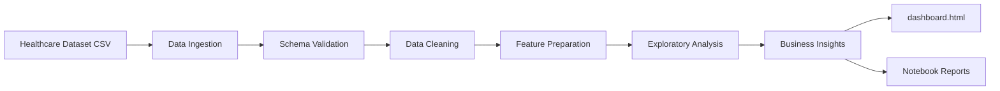
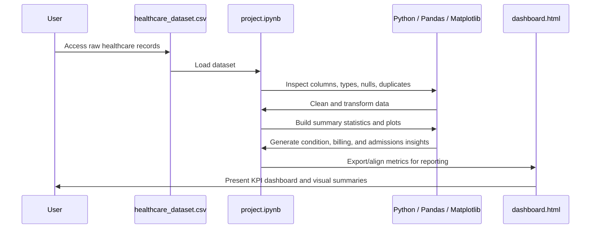
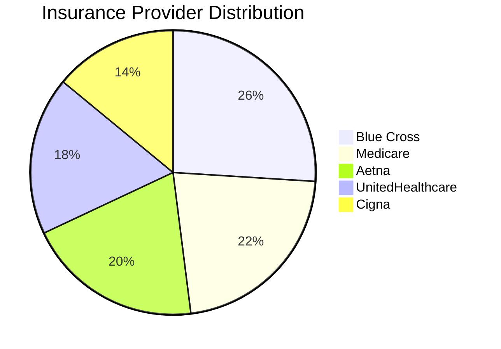
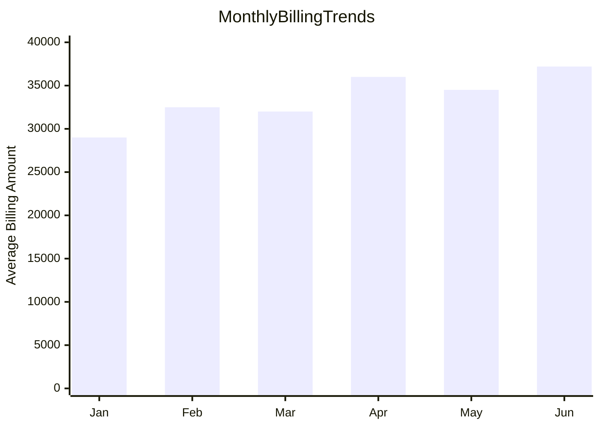

# Healthcare Analytics Project

This project analyzes a synthetic healthcare dataset to uncover trends in patient demographics, medical conditions, billing patterns, and hospital performance. The work is implemented in a Jupyter notebook for analysis and an HTML dashboard for executive-style reporting.

## Dataset

Download the raw dataset from Kaggle:

https://www.kaggle.com/datasets/prasad22/healthcare-dataset

## Project Structure

```text
HealthCare_Analytics/
├── healthcare_dataset.csv      # Source healthcare dataset
├── project.ipynb              # Exploratory data analysis and visualizations
├── dashboard.html             # Interactive dashboard for reporting
├── readme.md                  # Project overview and workflow documentation
```

## System Architecture

The architecture follows a simple end-to-end analytics pipeline: raw data ingestion -> data validation and cleaning -> feature preparation -> exploratory analysis -> dashboard reporting.



### Layer Responsibilities

- Data layer: `healthcare_dataset.csv`
  - Contains patient-level fields such as age, gender, medical condition, billing amount, insurance provider, admission type, hospital, medications, and test results.
- Analysis layer: `project.ipynb`
  - Loads data, checks nulls and duplicates, reviews data types, and creates summary statistics.
  - Builds visual insights around age distribution, billing trends, insurance mix, medical conditions, and admission patterns.
- Presentation layer: `dashboard.html`
  - Aggregates key KPIs and provides a browser-based dashboard for quick stakeholder review.
  - Designed to summarize operational and financial performance in an executive-friendly format.

## Complete Workflow



## Data Processing Workflow

1. Data acquisition
   - The project begins by loading the Kaggle healthcare dataset into a pandas DataFrame.
2. Data inspection
   - The notebook checks dataset shape, dtypes, missing values, and duplicate rows.
3. Data cleaning
   - Duplicate records are removed.
   - Columns are normalized for analysis and basic quality checks are performed.
4. Exploratory analysis
   - Age distribution is analyzed with histograms.
   - Medical conditions are counted to reveal patient demand patterns.
   - Billing amounts are grouped by admission month to identify financial trends.
   - Insurance provider coverage is visualized to understand payer mix.
   - Admission types and hospital activity are evaluated for operational insights.
5. Reporting
   - Key business findings are surfaced through a dashboard and notebook-based storytelling.

## Key Analytics Performed

The notebook explores several important healthcare indicators, including:

- Age distribution of patients
- Most common medical conditions
- Monthly billing and cost patterns
- Admission type distribution (emergency, urgent, elective, etc.)
- Insurance provider segmentation
- Relationship between patient age and billing amount
- Hospital and doctor-level operational metrics

## Example Visualizations

The analysis includes charts such as:





```mermaid
bar title Common Medical Conditions
    "Diabetes" 30
    "Cancer" 24
    "Asthma" 18
    "Obesity" 16
    "Arthritis" 12
```

## Dashboard Overview

The dashboard (`dashboard.html`) is built as a lightweight executive view and includes:

- KPI cards for key summary measures
- Filters for date range and performance dimensions
- Visual comparisons across medical conditions, billing, and hospital metrics
- An easy-to-read layout suitable for analysis and presentation

## Tools and Technologies

- Python
- Pandas
- NumPy
- Matplotlib
- Jupyter Notebook
- HTML / CSS / JavaScript for the dashboard

## How to Use

1. Download the dataset from the Kaggle link above.
2. Place the CSV in the project folder as `healthcare_dataset.csv`.
3. Open `project.ipynb` in Jupyter to explore the analysis.
4. Open `dashboard.html` in a browser to view the dashboard.

## Business Impact

This project demonstrates how healthcare data can be used to:

- monitor patient inflow and service demand,
- identify cost drivers,
- understand payer mix,
- evaluate operational trends,
- support executive decision-making using clear visual analytics.

This is a practical example of healthcare analytics from raw data collection through exploratory analysis to decision-support dashboarding.
